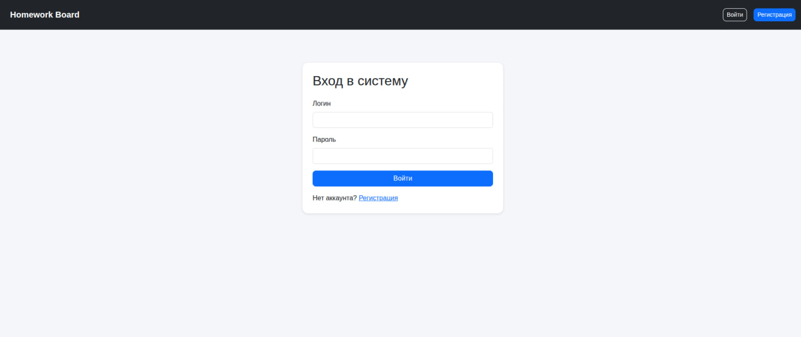
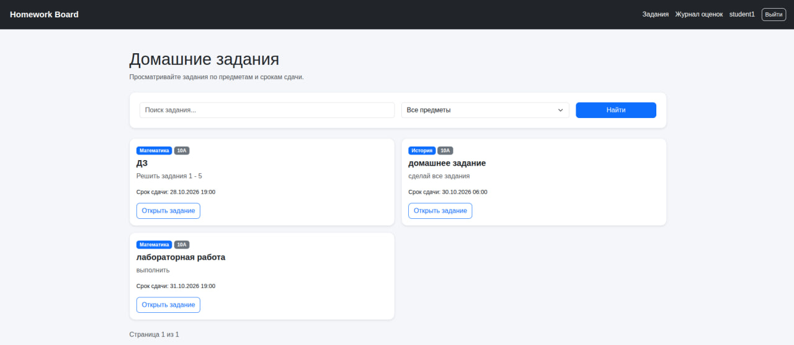
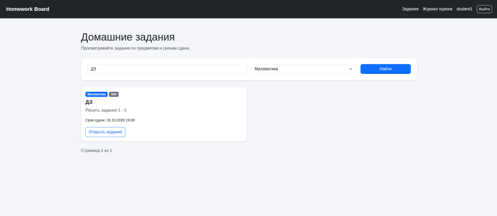
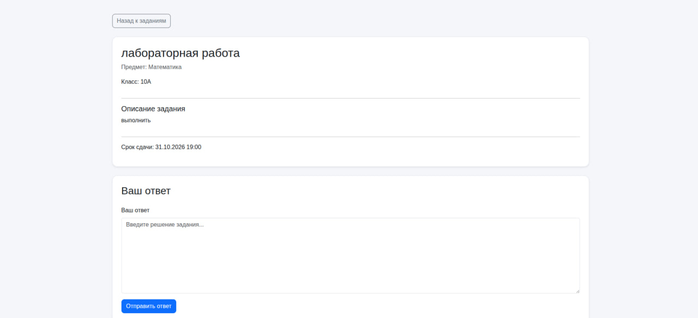
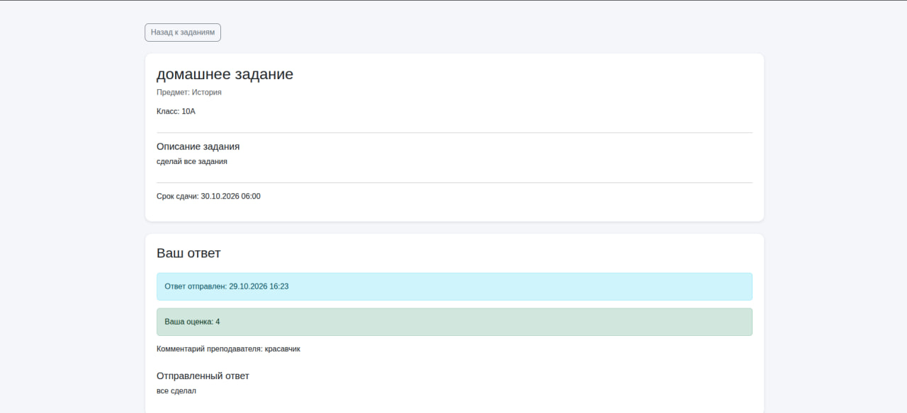
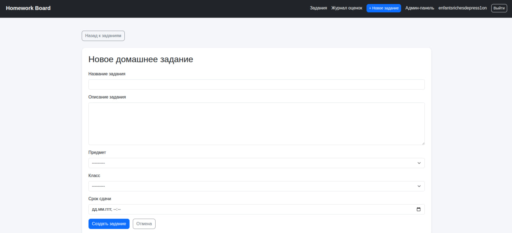
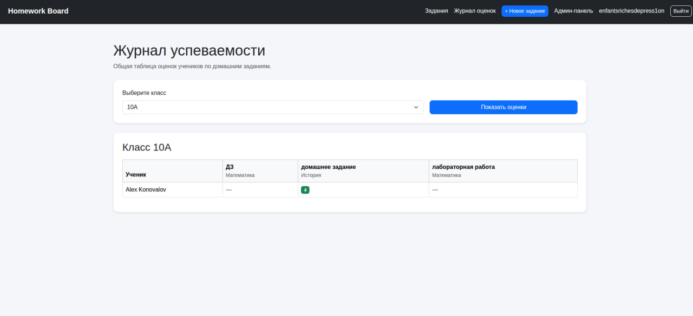

# Лабораторная работа №2

Тема: Разработка простого сайта на Django

Вариант 2 — Доска домашних заданий

Выполнил: Марусяк Никита  
Группа: К3242

## Цель работы

Овладеть практическими навыками разработки веб-приложений с использованием фреймворка Django, шаблонизатора Jinja2 и системы управления базами данных PostgreSQL.

## Используемые технологии

- Python 3.12 — язык программирования.
- Django 5.2 — веб-фреймворк.
- PostgreSQL — система управления базами данных.
- Jinja2 — шаблонизатор HTML-страниц.
- Bootstrap 5 — оформление пользовательского интерфейса.
- MkDocs — создание документации проекта.

## 1. Описание проекта

В рамках лабораторной работы разработано веб-приложение Homework Board — электронная доска домашних заданий.

Система предназначена для взаимодействия учеников и преподавателей.

Ученики могут регистрироваться, просматривать задания своего класса, отправлять текстовые ответы и получать оценки.

Преподаватели могут создавать задания, просматривать ответы учеников, выставлять оценки и комментарии.

Реализовано разграничение прав пользователей на основе встроенной системы авторизации Django.

## 2. Разработка базы данных

Для хранения информации используется PostgreSQL.

В Django реализованы следующие модели:

1. SchoolClass — информация о школьных классах.
2. StudentProfile — связь ученика с классом.
3. Subject — список учебных предметов.
4. Assignment — домашние задания.
5. Submission — ответы учеников и результаты проверки.

Модель Assignment содержит название задания, описание, предмет, класс, преподавателя и срок сдачи.

Модель Submission содержит текст ответа, дату отправки, оценку и комментарий преподавателя.

Связи между таблицами реализованы средствами Django ORM.

Для создания таблиц базы данных использовались команды:

```bash
python manage.py makemigrations
python manage.py migrate
```

## 3. Регистрация и авторизация

Реализована регистрация новых учеников с выбором школьного класса.

Для авторизации используется встроенный механизм Django Authentication.

После успешного входа пользователь получает доступ к интерфейсу в соответствии со своими правами.



## 4. Просмотр домашних заданий

На главной странице отображается список домашних заданий.

Каждое задание содержит название, предмет, класс, описание и срок сдачи.

Обычный ученик видит задания только своего класса. Преподаватель имеет доступ ко всем заданиям.

Для просмотра подробной информации предусмотрена отдельная страница задания.



## 5. Поиск, фильтрация и пагинация

Реализован поиск домашних заданий по названию и описанию.

Предусмотрена фильтрация по учебному предмету.

Для разбиения результатов на страницы используется Django Paginator. На одной странице отображается не более пяти заданий.



## 6. Отправка домашних заданий

Ученик может открыть домашнее задание и отправить решение в текстовом виде.

Ответ сохраняется в базе данных PostgreSQL.

До окончания срока сдачи и до выставления оценки ученик может редактировать отправленный ответ.

После выставления оценки редактирование блокируется.



## 7. Проверка и оценивание работ

Преподаватель может просматривать ответы учеников на домашние задания.

Для каждого отправленного ответа предусмотрена отдельная страница проверки.

Преподаватель выставляет оценку по пятибалльной шкале и при необходимости добавляет комментарий.

После сохранения результатов проверки ученик может просмотреть свою оценку и комментарий преподавателя.



## 8. Создание домашних заданий

Преподаватель может создавать новые задания непосредственно через пользовательский интерфейс сайта.

При создании указываются название, описание, предмет, класс и срок сдачи.

Автор задания определяется автоматически по текущему авторизованному пользователю.

Редактирование существующих заданий доступно через административную панель Django.



## 9. Журнал успеваемости

Реализован журнал оценок, отображающий результаты выполнения домашних заданий учениками класса.

В таблице представлены ученики, задания и выставленные оценки.

Преподаватель может выбирать класс и просматривать его успеваемость.

Ученикам доступен журнал своего класса.



## 10. Разграничение прав пользователей

В приложении реализованы две основные роли: ученик и преподаватель.

Ученик может просматривать задания своего класса, отправлять ответы и просматривать оценки.

Преподаватель может создавать задания, проверять ответы, выставлять оценки и просматривать журналы разных классов.

Разделение прав реализовано средствами Django с использованием поля is_staff.

Проверки выполняются как в HTML-шаблонах, так и в обработчиках запросов.

## 11. Проверка работоспособности

В ходе тестирования были проверены следующие функции:

- Регистрация нового ученика.
- Авторизация ученика и преподавателя.
- Просмотр домашних заданий.
- Поиск и фильтрация заданий.
- Отправка и изменение ответа.
- Проверка ответа преподавателем.
- Выставление оценки и комментария.
- Создание нового задания.
- Просмотр журнала успеваемости.
- Ограничение доступа в зависимости от роли пользователя.

Проверка показала корректную работу основных функций веб-приложения.

## Вывод

В ходе выполнения лабораторной работы разработано веб-приложение Homework Board с использованием Django, Jinja2 и PostgreSQL.

Реализованы регистрация и авторизация пользователей, управление домашними заданиями, отправка ответов, выставление оценок и просмотр журнала успеваемости.

Дополнительно реализованы поиск, фильтрация, пагинация и разграничение прав доступа.

В результате получены практические навыки работы с Django ORM, PostgreSQL, HTML-шаблонами, обработкой HTTP-запросов и системой авторизации Django.